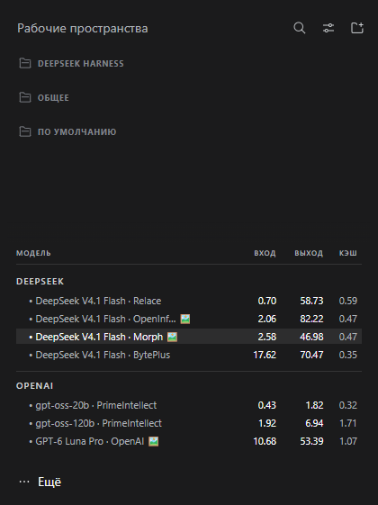

# dsh-routerai-prices

[Русский](#русский) · [English](#english)

---

## Русский

Плагин для [DeepSeek Harness](https://github.com/deepseek-ai/deepseek-harness): таблица цен **RouterAI** для моделей вашего профиля, активная подсвечена.



### Что показывает

- **Ваши модели** — ровно те, что настроены в профиле, вместе с закреплённым провайдером.
- **Цены** — стоимость запроса, ответа и чтения из кэша по каждой модели на момент опроса.
- **Подсветка** — активная модель выделена.
- **Картинки** — модели, принимающие изображения, помечены.

### Настройка

На странице плагина (**Плагины → Цены RouterAI**) есть поле **«RouterAI · интервал обновления цен»**: от 1 до 60 минут, по умолчанию 5. Тарифы меняются редко, поэтому счёт здесь идёт на минуты.

### Требования

- Хотя бы одна модель в профиле — плагин берёт их список из harness.

Без моделей таблица останется пустой: показывать нечего.

### Установка

**Магазин.** Плагины → Plugin Market → найдите `dsh-routerai-prices`.

**Кнопка «Добавить плагин».** Плагины → Добавить плагин:

```
github:dev-cmde/dsh-routerai-prices
```

**Командная строка.** Приложение использует профиль `desktop`, веб-версия — `web`:

```sh
# приложение
dsh plugin --profile desktop add github:dev-cmde/dsh-routerai-prices

# веб-версия
dsh plugin --profile web add github:dev-cmde/dsh-routerai-prices
```

### Лицензия

MIT — см. [LICENSE](LICENSE).

---

## English

A [DeepSeek Harness](https://github.com/deepseek-ai/deepseek-harness) plugin: **RouterAI** prices for the models in your profile, with the active one highlighted.


### What it shows

- **Your models** — exactly the ones configured in your profile, provider pin included.
- **Prices** — prompt, completion and cached-read cost per model as of each poll.
- **Highlight** — the active model stands out.
- **Images** — models that accept images are marked.

### Configuration

The plugin page (**Plugins → RouterAI prices**) has a **RouterAI · price refresh interval** field: 1 to 60 minutes, 5 by default. Tariffs change rarely, so this one counts in minutes.

### Requirements

- At least one model in your profile — the plugin reads their list from the harness.

With no models the table stays empty: there is nothing to price.

### Installation

**Plugin market.** Plugins → Plugin Market → search for `dsh-routerai-prices`.

**The "Add plugin" button.** Plugins → Add plugin:

```
github:dev-cmde/dsh-routerai-prices
```

**Command line.** The desktop app uses the `desktop` profile, the web version uses `web`:

```sh
# desktop app
dsh plugin --profile desktop add github:dev-cmde/dsh-routerai-prices

# web version
dsh plugin --profile web add github:dev-cmde/dsh-routerai-prices
```

### License

MIT — see [LICENSE](LICENSE).
